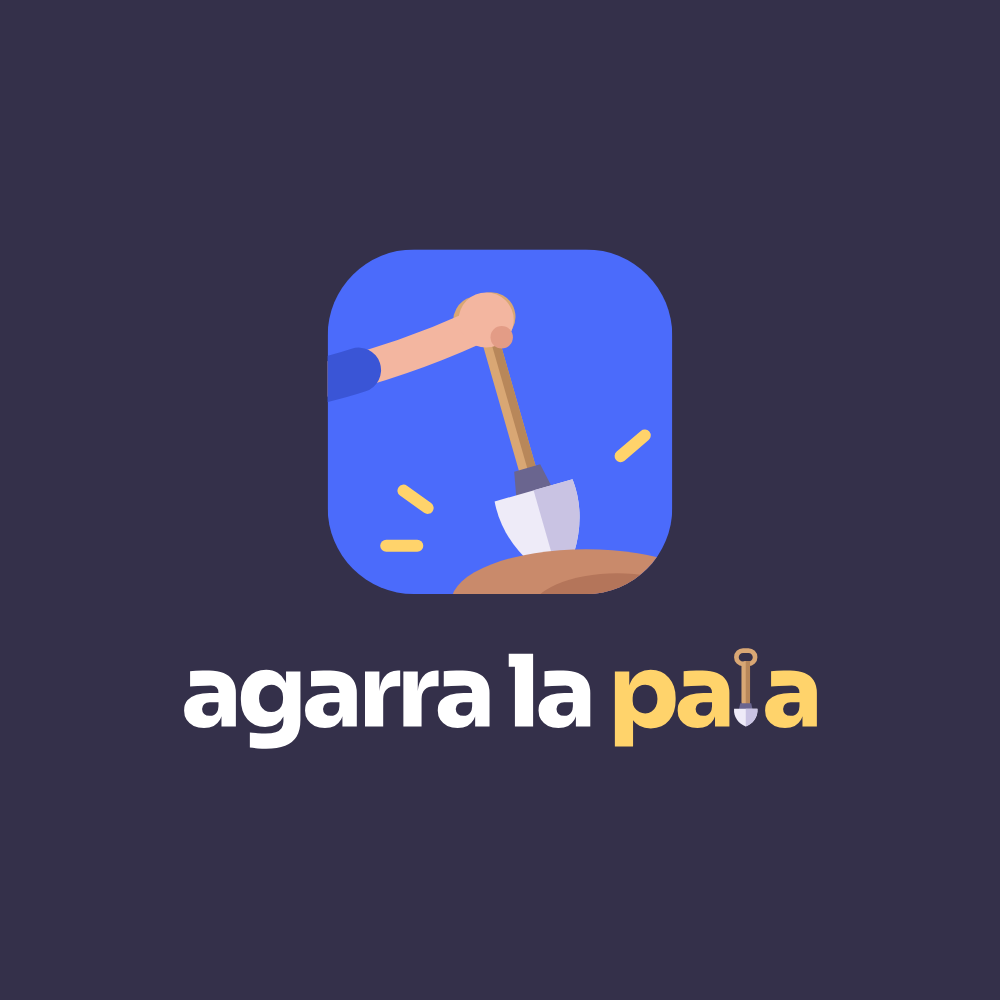

# Agarrar la pala



Track: Simulations · Platanus Hack 26 Santiago, team 32

Tu gemelo digital vive tus decisiones de carrera antes que tú. Eliges qué hace año a año (sabático, cambiar de pega, trabajar más, estudiar) y el simulador corre miles de futuros posibles para mostrarte el rango de resultados, no un único número

## Stack

- `backend/`: FastAPI + motor Monte Carlo en numpy
- `frontend/`: Vite + React + TypeScript
- `supabase/`: esquema y migraciones

## Correr local

```bash
make install
make back    # http://localhost:8000/docs
make front   # http://localhost:5173
```

Detalles de arquitectura en [DEV.md](DEV.md).

## Equipo

- José Tomás Valdivia ([@jtvaldivia](https://github.com/jtvaldivia))
- Vicente Cruz ([@vicente-cruz-labra](https://github.com/vicente-cruz-labra))
- Cristóbal Pérez-cotapos ([@cristobalperez-cotapos](https://github.com/cristobalperez-cotapos))
- Benito Palacios Medeiros ([@benitopalaciosm](https://github.com/benitopalaciosm))
- Alonso Peralta Sarrat ([@aperaltas16](https://github.com/aperaltas16))
